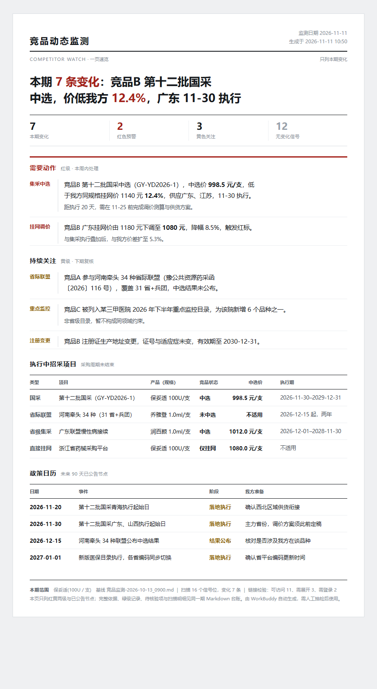

# 竞品公开情报监控 · Competitive Intel Brief

一个 Agent Skill：把药企与医美竞品的公开信息，做成**每条都能回源的字段矩阵**，再从中提炼一页速览。

适用于 WorkBuddy、Claude Code 等读取 `SKILL.md` 的 agent。



## 为什么不是「直接写份周报」

竞品监测通常败在两个地方：

- **只报变化**。这期只写「谁降价了」，下期想比对时手上没有基线，diff 不出任何东西。
- **结论追不回来源**。数字写得漂亮，被问一句「这个价从哪来的」就整份作废。

这个技能的默认姿态是反过来的：**矩阵保全量、每行带可点网址、逐省逐规格展开、缺哪格一眼可见**，然后才写文档，每句结论必须带行号。

## 产出（每期五份）

| 文件 | 用途 |
|---|---|
| `竞品矩阵-<日期>_<时刻>-产品(规格).md` | 主台账。七节：主矩阵 / 招采展开 / 附件清单（含名单核对、新发现对手）/ 待人工确认 / 冲突记录 / 字段覆盖 / 统计 |
| 同上 `.xlsx` | 九个 sheet，按重点竞品上色，可直接筛选 |
| `竞品监测-<日期>_<时刻>-产品(规格).md` | 变化文档，结论带 `[M01]` `[T03]` `[N02]` 行号 |
| 同上 `.html` | 一页速览，只放红黄级与已公告节点 |
| 同上 `.xlsx` | 十个 sheet，含价格对照、省份覆盖 |

## 安装

macOS / Linux：

```bash
git clone https://github.com/wzf5251/competitive-intel-brief.git \
  ~/.workbuddy/skills/competitive-intel-brief
```

Windows PowerShell：

```powershell
git clone https://github.com/wzf5251/competitive-intel-brief.git "$env:USERPROFILE\.workbuddy\skills\competitive-intel-brief"
```

目录名保持 `competitive-intel-brief`，与 `SKILL.md` 的 `name` 字段一致。Claude Code 用户把目标路径换成 `~/.claude/skills/competitive-intel-brief` 即可，格式通用。

## 开始用

第一次直接说「盯一下这几个竞品」，技能会引导你建 `config/watchlist.md`（在**你的工作空间**里，不在技能目录）。三件事必填：

```yaml
entry_mode: watch          # watch=盯已知对手｜discover=帮我找｜scan=怕漏掉新的
```

```markdown
- 某竞品 | 某企业 | 直接 | 三类器械 | 1.0ml/支 | 鼻唇沟填充 | deep | price
```

```yaml
fields: price              # price 22 项｜access 22 项｜tender 20 项｜all 36 项
```

填完再跑一次，产物落在工作空间的 `竞品监测/` 目录。

**想看效果又不想配**：直接说「临时查一下 XX 的挂网价」，单次模式不建配置也能出矩阵和文档。

## 目录

```
config/watchlist.md     监测谁、看哪些字段、什么算变化（在用户工作空间，不入库）
竞品资料/                价格表、线下文件、历史矩阵（可选）
竞品监测/                每期产物
```

## 自检

落盘后技能会自动跑 `scripts/verify_output.py`，检查行号连续性、枚举合法性、省份去重、附件清单完整性、跨表数字一致性、HTML 占位符残留等 60 余项。手动复检：

```bash
python ~/.workbuddy/skills/competitive-intel-brief/scripts/verify_output.py \
  "竞品监测/竞品矩阵-2026-11-11_0930-某产品(1.0ml／支).md" --check-links
```

`--check-links` 会真实打开产物里的链接（最多 30 条），按「可达 / 被拦 / 失效 / 连不上 / 证书异常」分类。**不加这个参数，就不得声称「链接已核验」**——技能里这条是硬规则。

## 设计原则

1. **矩阵是全量快照**。上期已确认、本期核验未变的行仍要落表，备注写 `沿用｜上期日期｜本期已核`。只写变化行的矩阵下期没法当基线。
2. **名单先抄全，再谈字段**。公告附件里的企业一个不漏，按「已监控 / 新增候选 / 非竞品」三类落表，`应识别 = 已监控 + 新增候选 + 非竞品` 逐份成立。
3. **省份与规格一条不省**。国采 32 个省级单元、联盟列明的全部成员省，一省一行；多规格分行，不合并成一个价。
4. **价格必标口径**。挂网价、集采中选价、中标价、零售价互不相减；价差率的分母是**我方价**，我方价没填就整列写「未提供」，不估。

## 兼容性

`SKILL.md` 使用标准 frontmatter（`name` + `description`），额外的 `display_name` / `version` 等字段不影响其他平台加载。依赖仅 Python 3 标准库——`make_xlsx.py` 直接写 OOXML，不需要 openpyxl；`verify_output.py` 只用 `urllib`。

## License

MIT，见 [LICENSE](LICENSE)。
